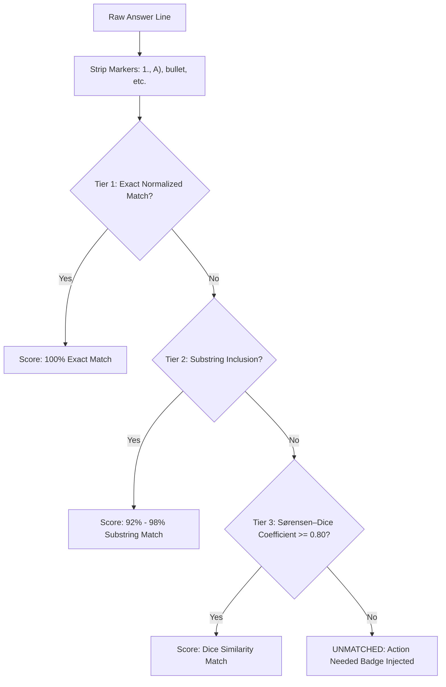

# FormFlow — Precision Autofill for Google Forms

[](https://developer.chrome.com/docs/extensions/mv3/intro/)
[](https://github.com/CyberCodezilla/auto_filler)
[](https://github.com/CyberCodezilla/auto_filler)
[](LICENSE)

**FormFlow** is a zero-hallucination Chrome Extension (Manifest V3) that parses raw, unformatted multiline answers and accurately maps them to Google Form questions using a **deterministic DOM-scraping and fuzzy-matching engine**.

No generative AI or LLMs are involved in the autofill process. The engine operates **100% locally and offline**, relying on text normalization, Sørensen–Dice bigram similarity with strict hard thresholds, and synthetic event dispatching tailored for Google's `Wiz` / `Closure` framework.

---

## Table of Contents
- [✨ Key Features](#-key-features)
- [📥 Installation Guide](#-installation-guide)
  - [Method 1: Quick Install via Release ZIP (Recommended)](#method-1-quick-install-via-release-zip-recommended)
  - [Method 2: Install from Source (For Developers)](#method-2-install-from-source-for-developers)
- [🚀 How to Use FormFlow (Step-by-Step)](#-how-to-use-formflow-step-by-step)
  - [Step 1: Open Google Form & Fill Identity Fields](#step-1-open-google-form--fill-identity-fields)
  - [Step 2: Open FormFlow](#step-2-open-formflow)
  - [Step 3: Paste Your Answers](#step-3-paste-your-answers)
  - [Step 4: Check Settings & Modes](#step-4-check-settings--modes)
  - [Step 5: Click Fill Form (or Press Ctrl+Enter)](#step-5-click-fill-form-or-press-ctrlenter)
  - [Step 6: Review with In-Page Badges & Audit Report](#step-6-review-with-in-page-badges--audit-report)
  - [Step 7: 1-Click Reversible Undo (Zero Data Loss)](#step-7-1-click-reversible-undo-zero-data-loss)
- [📝 Supported Answer Formats](#-supported-answer-formats)
- [🎯 Supported Google Form Field Types](#-supported-google-form-field-types)
- [🧠 How the Matching Engine Works](#-how-the-matching-engine-works)
- [⌨️ Keyboard Shortcuts](#-keyboard-shortcuts)
- [❓ Troubleshooting & FAQs](#-troubleshooting--faqs)
- [🧪 Development & Testing](#-development--testing)

---

## ✨ Key Features

- **Zero-Hallucination Architecture:** 100% deterministic matching with a 3-tier waterfall (Exact Normalized Match, Substring Inclusion, Sørensen–Dice Coefficient $\ge 0.80$). Anything below the 0.80 threshold is strictly marked as `Action Needed` rather than guessing.
- **Smart Identity Field Skipping:** Automatically detects pre-filled identity questions (Full Name, Email, Roll Number, Registration ID) and **skips them automatically**, mapping `Answer[0]` to the first actual quiz question.
- **Reversible Undo / Reset:** Restores the exact prior state of the form instantly with 1 click without erasing your pre-filled personal information.
- **Support for All Field Types:** Radio buttons, multi-select checkboxes, short text inputs, paragraph textareas, and dropdown menus.
- **Visual Confidence Badges:** Floating status badges injected right above each question card on the Google Form:
  - <span style="color:#10b981;">**✓ Filled (Exact)**</span> (Emerald)
  - <span style="color:#3b82f6;">**≈ Filled (95% Match)**</span> (Blue/Amber)
  - <span style="color:#71717a;">**↷ Skipped (Pre-filled)**</span> (Zinc/Slate)
  - <span style="color:#ef4444;">**✕ Action Needed**</span> (Crimson)
- **Interactive Audit Report:** View accuracy statistics, completion progress bar, question-by-question breakdown, and click **Jump** to smoothly scroll directly to any question card.
- **100% Privacy & Offline:** No data leaves your machine. No accounts, no API keys, and no telemetry.

---

## 📥 Installation Guide

### Method 1: Quick Install via Release ZIP (Recommended)

1. Go to the [Releases](https://github.com/CyberCodezilla/auto_filler/releases) page of this repository.
2. Under the latest release (e.g. `v1.0.0`), download **`formflow-v1.0.0.zip`**.
3. Extract (unzip) the file into a folder on your computer (e.g., `Documents/FormFlow` or `Desktop/FormFlow`).
4. Open **Google Chrome** and navigate to:
   ```text
   chrome://extensions/
   ```
5. In the top-right corner, turn on the **Developer mode** toggle.
6. In the top-left corner, click the **Load unpacked** button.
7. Select the extracted folder containing `manifest.json`.
8. **Pin the extension:** Click the puzzle icon (Extensions) in your Chrome toolbar, find **FormFlow — Precision Autofill**, and click the pin icon 📌 for instant access!

---

### Method 2: Install from Source (For Developers)

1. Clone the repository:
   ```bash
   git clone https://github.com/CyberCodezilla/auto_filler.git
   cd auto_filler
   ```
2. Build the production package (optional):
   ```bash
   node scripts/build.js
   ```
3. Open `chrome://extensions/` in Chrome.
4. Enable **Developer mode**.
5. Click **Load unpacked** and choose either the repository root directory or the generated `dist/` folder.

---

## 🚀 How to Use FormFlow (Step-by-Step)

### Step 1: Open Google Form & Fill Identity Fields
Open the target Google Form in Chrome. If the form starts with student/user identity details (such as **Full Name**, **Email Address**, or **Roll No / Student ID**), type or select them manually as you normally would.

> [!TIP]
> **FormFlow is identity-aware!** It detects any questions you've already answered and automatically skips them so your quiz answers aren't accidentally inserted into your Name or Email fields.

---

### Step 2: Open FormFlow
Click the **FormFlow** icon ⚡ in your Chrome toolbar.
- The popup displays real-time connection status in the header:
  `● Connected (13 Qs • 3 Filled • 10 To Fill)`
- The counter badge clearly tells you how many questions remain to be answered.

---

### Step 3: Paste Your Answers
Paste your raw, multiline answers into the text area. 

```text
Radio frequency band
To carry the signal from transmitter to receiver
Increased spectrum efficiency
Network name
It generally decreases
2.4 GHz
Bluetooth
Reduction in signal power during propagation
RSSI
Transferring an ongoing connection from one cell to another
```

* **Live Line Counter:** FormFlow automatically displays the total parsed answers (e.g., `10 answers ready`).
* **Testing:** If you want to test the extension, click the **Load PRD Sample** button to automatically populate test answers.

---

### Step 4: Check Settings & Modes

Right beneath the answer box, you have two quick options:

1. **`[✓] Skip already-filled fields (Name, Roll No)`** *(Enabled by default)*:
   Keeps pre-filled personal information untouched and starts matching `Answer[0]` on the first unanswered question.
2. **Mode Selection:**
   - **Sequential Mapping (1:1)** *(Default)*: Matches answers line-by-line sequentially (`Answer 1 -> Question 1`, `Answer 2 -> Question 2`).
   - **Smart Shuffle (Option Pool)**: Use this when the Google Form has **"Shuffle question order"** turned on. FormFlow scans all unanswered choice questions to find the matching question regardless of order.

---

### Step 5: Click Fill Form (or Press Ctrl+Enter)
Click the primary **Fill Form** button or press:
- `Ctrl + Enter` (Windows / Linux)
- `Cmd + Enter` (macOS)

In milliseconds, FormFlow dispatches synthetic events (`input`, `change`, `pointerdown`, `click`) to trigger Google Forms' reactive form state.

---

### Step 6: Review with In-Page Badges & Audit Report
Immediately after filling, FormFlow switches to the **Audit Report** tab:

1. **Overall Progress & Metrics:**
   - Completion bar (e.g., `10 / 10 Questions Filled (100%)`).
   - Count breakdown: `Exact`, `Fuzzy`, `Pre-filled`, `Action Needed`.
2. **Interactive Jump Navigation:**
   - Each question card in the audit report has a **Jump** button.
   - Clicking **Jump** smoothly scrolls your browser directly to that question card and flashes a glowing focus highlight.
3. **In-Page Floating Badges:**
   - On the Google Form page itself, each question card receives a neat visual badge:
     - `✓ Filled (Exact)` — 100% string match.
     - `≈ Filled (95% Match)` — High-confidence fuzzy match.
     - `↷ Skipped (Pre-filled)` — Pre-existing personal detail preserved.
     - `✕ Action Needed` — Similarity was below threshold; left untouched for safety.

---

### Step 7: 1-Click Reversible Undo (Zero Data Loss)
Need to change answers or reset?
- Click the **Undo Fill** button in the FormFlow popup.
- All fields populated by FormFlow will be cleared and reset to their prior state, and in-page badges will be removed.
- **Safety Guarantee:** Any personal information you filled manually (Name, Email, Roll No) is **never erased**.

---

## 📝 Supported Answer Formats

FormFlow includes an intelligent pre-parser that automatically cleans up dirty or formatted text:

| Input Style | Example | Parsed As |
|---|---|---|
| **Plain Text** | `2.4 GHz` | `2.4 GHz` |
| **Numbered Lists** | `1. Radio frequency band` | `Radio frequency band` |
| **Lettered Lists** | `A) Network name` | `Network name` |
| **Bullet Points** | `• Increased spectrum efficiency` | `Increased spectrum efficiency` |
| **Dash Lists** | `- Reduction in signal power` | `Reduction in signal power` |
| **Decimal Protection** | `2.4 GHz` (doesn't strip `2.`) | `2.4 GHz` preserved intact |
| **Multi-Select Checkboxes** | `Option A, Option C` or `A; B` | Selects both options on checkbox questions |

---

## 🎯 Supported Google Form Field Types

| Field Type | DOM Selector | Synthetic Event Handling |
|---|---|---|
| **Multiple Choice** | `div[role="radio"]` | Dispatches `pointerdown`, `mousedown`, `click` on active option wrapper |
| **Checkboxes** | `div[role="checkbox"]` | Toggles each matching choice for multi-answer questions |
| **Short Answer** | `input[type="text"]`, `input[type="email"]`, etc. | Dispatches native property setter + `input` and `change` events |
| **Paragraph** | `textarea` | Updates value and triggers auto-resizing input events |
| **Dropdown Menus** | `div[role="listbox"]` | Triggers popup menu, queries active options, selects match |
| **Linear Scale** | `div[role="radiogroup"]` | Matches numerical and labeled rating nodes |

---

## 🧠 How the Matching Engine Works

FormFlow guarantees **zero hallucinations** by replacing generative AI with a strict 3-tier deterministic cascade:



1. **Text Normalization:**
   - Strips non-standard punctuation, collapses whitespace, normalizes unicode curly quotes and em-dashes, and converts to lowercase.
2. **Tier 1: Exact Normalized Match (100% Confidence)**
   - Compares stripped answers directly against option labels. Handles spacing variations (e.g., `2.4 GHz` vs `2.4GHz`).
3. **Tier 2: Substring Match (92% - 98% Confidence)**
   - Catches cases where the answer is contained within the question option (e.g., `RSSI` inside `RSSI (Received Signal Strength Indicator)`).
4. **Tier 3: Sørensen–Dice Bigram Similarity ($\ge 0.80$ Hard Threshold)**
   - Compares character bigrams:
     $$\text{Dice}(A, B) = \frac{2 \times |A \cap B|}{|A| + |B|}$$
   - Tolerates minor typographical errors. If the similarity is under **0.80**, FormFlow refuses to guess and leaves the question blank for manual user action.

---

## ⌨️ Keyboard Shortcuts

| Shortcut | Action | Where |
|---|---|---|
| `Ctrl + Enter` (Windows/Linux) | Trigger Form Fill | Inside FormFlow Popup |
| `Cmd + Enter` (macOS) | Trigger Form Fill | Inside FormFlow Popup |
| `Escape` | Close Popup | Anywhere |

---

## ❓ Troubleshooting & FAQs

### Q: Why does the popup say "Not Connected (Open a Google Form)"?
FormFlow activates only on active Google Forms tabs (`https://docs.google.com/forms/*`). Make sure:
1. You are on a live Google Form (or a local test HTML file with form permissions enabled).
2. The page has finished loading.
3. Refresh the Google Form page and reopen the FormFlow popup.

### Q: What if the Google Form has multiple pages (sections)?
Google Forms only renders DOM elements for the currently active section.
1. Fill in the answers for Section 1 with FormFlow.
2. Click **Next** on Google Forms.
3. Open FormFlow and fill the answers for Section 2.

### Q: Can FormFlow fill forms with "Shuffle question order" enabled?
**Yes!** Switch from **Sequential** mode to **Smart Shuffle** mode in the popup. FormFlow will search the global pool of choice questions to match answers to options regardless of order.

### Q: Does FormFlow automatically submit the form?
**No.** FormFlow intentionally **never auto-submits**. You maintain 100% control to review answers and badges before manually clicking the Submit button.

---

## 🧪 Development & Testing

FormFlow includes an automated unit & integration test suite covering list marker stripping, normalization, Sørensen–Dice bigram metrics, and pre-filled skip logic.

Run the test suite using Node.js:
```bash
node tests/test_engine.js
```

### Packaging a New Production Release:
```bash
node scripts/build.js
```
This builds a hardened distribution in `dist/` and creates a production-ready ZIP archive in `release/formflow-v1.0.0.zip`.

---

## 📄 License
This project is open-source under the [MIT License](LICENSE).
